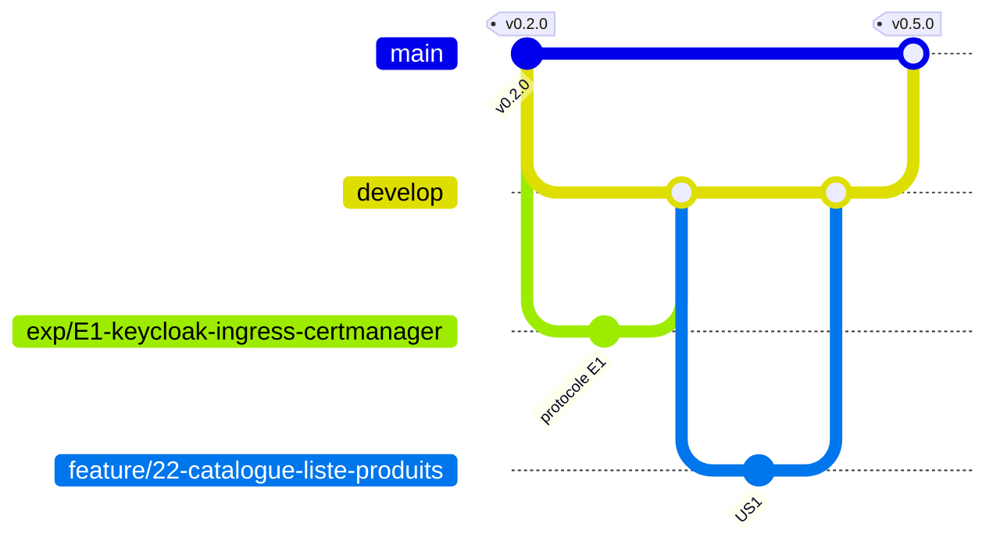

# Contribuer au projet

Ce guide décrit comment le travail circule dans le dépôt : branches, commits, revues, versions et livraisons. Il applique les politiques définies dans `docs/05-cycle-devsecops.md`, `docs/06-politique-tests.md` et `docs/07-politique-securite.md`.

## 1. Modèle de branches (GitFlow allégé)



| Branche | Rôle | Créée depuis | Fusionnée dans | Protection |
|---|---|---|---|---|
| `main` | Version livrable. Chaque version est taguée `vX.Y.Z`. | – | – | PR obligatoire, CI verte, pas de force-push |
| `develop` | Intégration continue, déployée automatiquement en *staging* | `main` | `main` (PR de release) | PR obligatoire, CI verte |
| `feature/<issue>-<slug>` | User story ou tâche technique | `develop` | `develop` | – |
| `exp/<E#>-<slug>` | Expérimentation en bac à sable (jalon 2) | `develop` | `develop` (protocole et résultats) | – |
| `fix/<issue>-<slug>` | Correction non urgente | `develop` | `develop` | – |
| `hotfix/<slug>` | Correction urgente d'une version publiée | `main` | `main` puis `develop` | – |
| `docs/<slug>` | Documentation seule | `develop` | `develop` | – |

Règles : une branche par issue, durée de vie courte (quelques jours), rebase sur `develop` avant la PR, suppression après la fusion.

## 2. Commits (Conventional Commits)
Format : `type(portée): résumé à l'impératif`. Exemples : `feat(order): publier OrderPlaced`, `test(stock): idempotence du rejeu`, `ci: scan Trivy bloquant`.

| Type | Usage |
|---|---|
| `feat` | Nouvelle fonctionnalité |
| `fix` | Correction de bug |
| `test` | Ajout ou correction de tests |
| `docs` | Documentation |
| `ci` | Pipelines GitHub Actions |
| `build` | Maven, Dockerfile, dépendances |
| `refactor` | Restructuration sans changement de comportement |
| `sec` | Correctif ou durcissement de sécurité |
| `chore` | Maintenance |

Référencer l'issue dans le corps (`Closes #25`) pour que le kanban passe la carte en *Terminé* à la fusion.

## 3. Cycle d'une issue sur le kanban
`Backlog` → `À faire` (prête : critères d'acceptation clairs) → `En cours` (branche créée) → `En revue` (PR ouverte) → `Terminé` (PR fusionnée, issue fermée).

## 4. Pull requests et revue
- Le modèle de PR (`.github/PULL_REQUEST_TEMPLATE.md`) reprend la *Definition of Done*.
- La CI (`CI / Résultat CI`) doit être verte avant la fusion.
- Projet individuel : la revue par un pair est remplacée par une **auto-revue outillée** (grille de revue sécurité du modèle de PR, revue de code automatisée CodeQL et SonarCloud). En équipe, une approbation est exigée (voir `docs/05-cycle-devsecops.md`).
- Fusion en *squash* sur `develop`, *merge commit* de `develop` vers `main` pour conserver l'historique de release.

## 5. Versions, tags et releases (SemVer)
- Tag annoté `vMAJEUR.MINEUR.CORRECTIF` sur `main` uniquement. Avant `v1.0.0`, chaque jalon livré incrémente le mineur.
- Publier une *release* GitHub déclenche `release.yml` : images versionnées sur GHCR, SBOM et rapport Trivy joints à la release, puis déploiement en production soumis à approbation.
- Le `CHANGELOG.md` est mis à jour dans la PR de release.

| Version | Jalon |
|---|---|
| `v0.1.0` | J0 — Cadrage technique |
| `v0.2.0` | J1 — Processus qualité (phase 1) |
| `v0.3.0` | Industrialisation du dépôt : CI/CD, gouvernance, audit |
| `v0.4.0` | J2 — Expérimentations E1 à E4 |
| `v0.5.0` | J3 — POC fonctionnel (US1 à US5) |
| `v0.6.0` | J4 — Sécurité, charge, remédiation |
| `v1.0.0` | J5 — Version présentée en soutenance |

## 6. Démarrer une tâche
```bash
git switch develop && git pull
git switch -c feature/22-catalogue-liste-produits
# ... travail, commits conventionnels ...
git push -u origin feature/22-catalogue-liste-produits
gh pr create --base develop --fill
```
