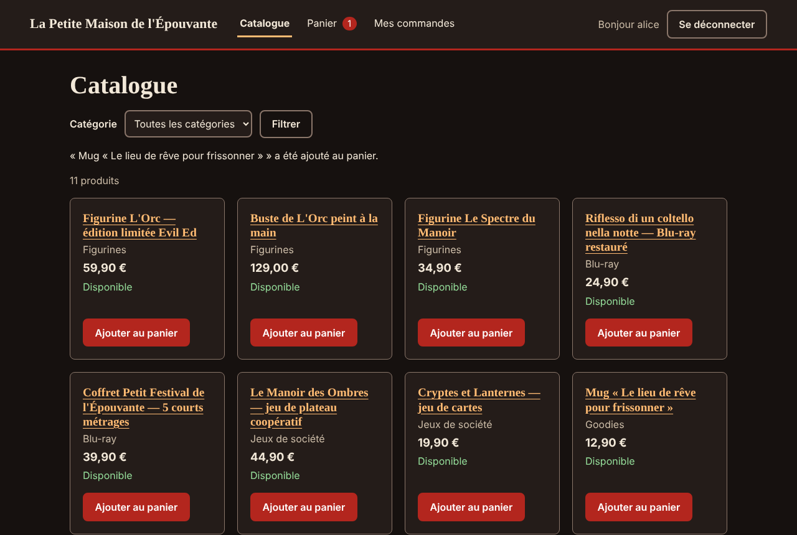
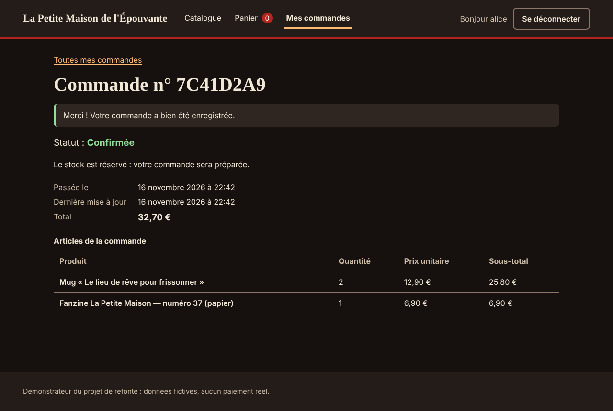
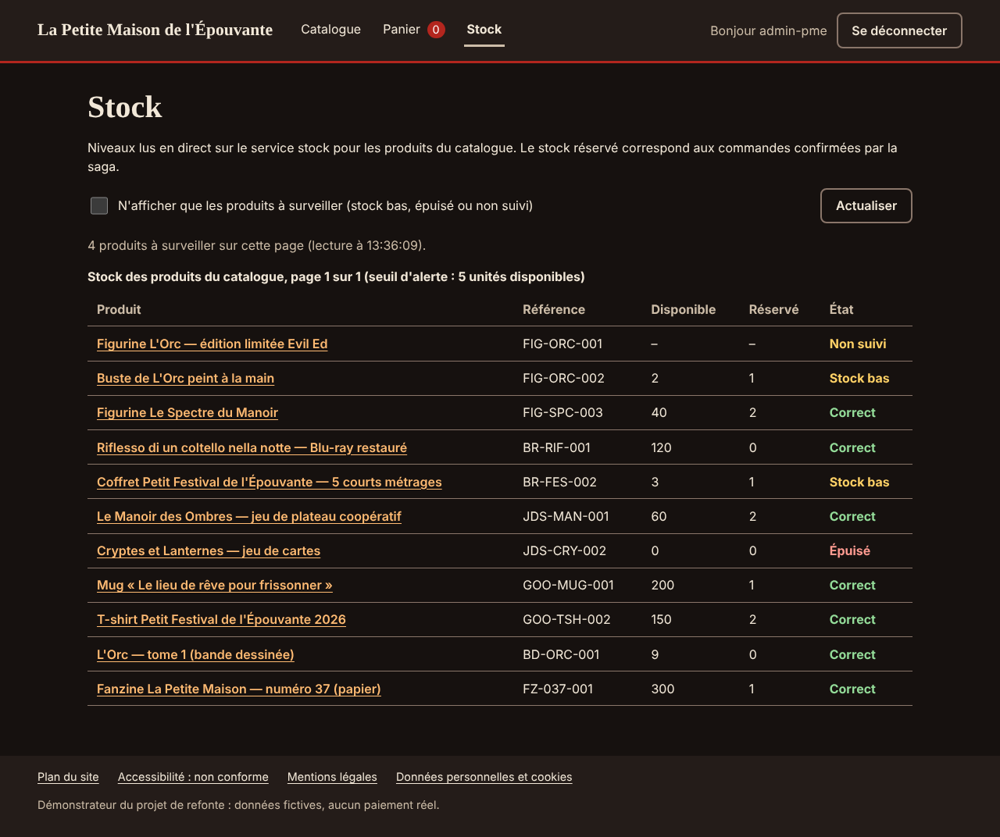
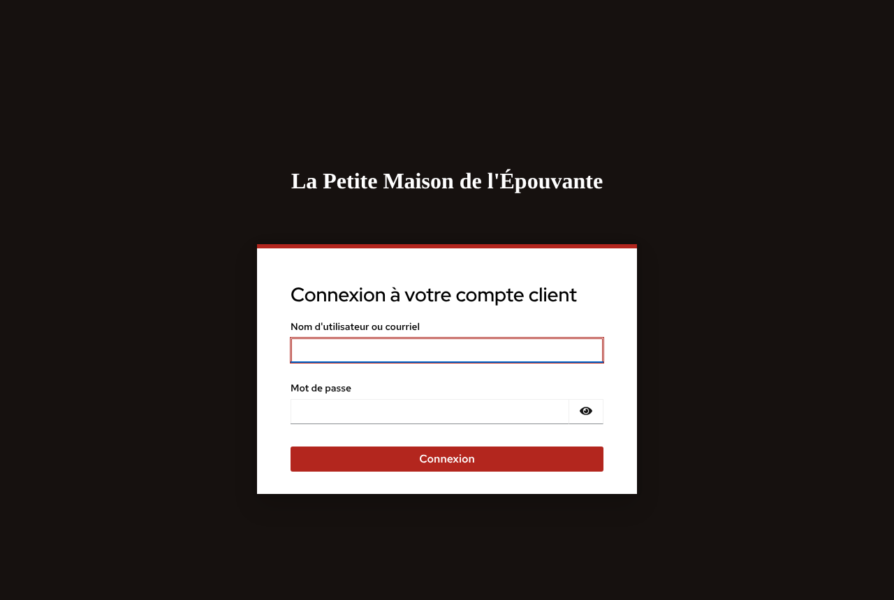
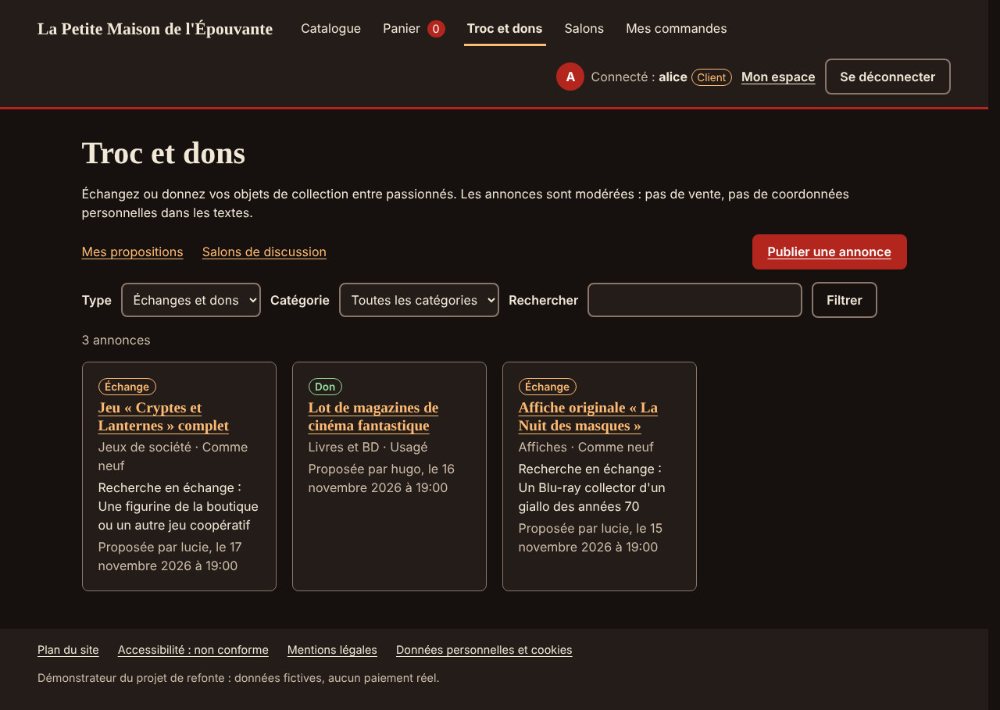
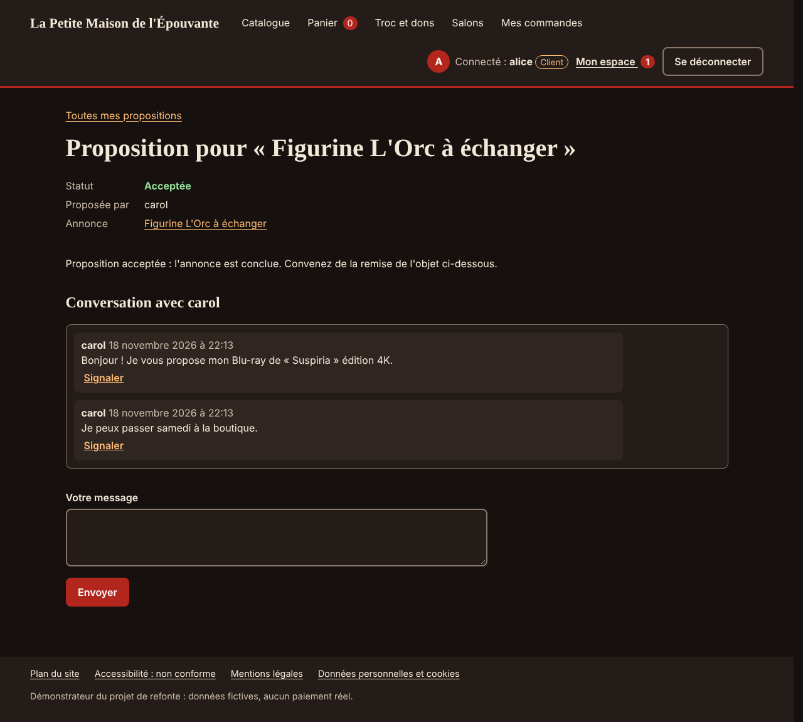

# petitemaisonepouvante.com — Plateforme e-commerce (architecture microservices)

[](https://github.com/mbanzaroger/petitemaisonepouvante/actions/workflows/ci.yml)
[](https://github.com/mbanzaroger/petitemaisonepouvante/actions/workflows/codeql.yml)
[](https://github.com/mbanzaroger/petitemaisonepouvante/releases)

> Projet individuel — Bloc CESI « Superviser et assurer le développement des applications logicielles ».
> Cas fictif : *La Petite Maison de l'Épouvante*. Rôle : Lead Developer.

## Périmètre du POC
Fonctionnalités métier implémentées, de bout en bout dans le navigateur :
- **commander un produit dérivé (figurines, goodies, Blu-ray) avec réservation de stock** (US1 à US7) ;
- **espace communautaire** : troc et dons entre particuliers, conversation privée et salons de discussion entre passionnés, objets recherchés et notifications, modération (US8 à US12, v1.3.0) ;
- **personnalisation** : recommandations de produits selon les recherches, consultations et achats, gamme exclusive Evil Ed, notifications selon la navigation, avec consentement (US13, US14) ;
- **éditions** : actualités et articles de fond ouverts à tous, fanzine numérique (extrait, achat, liseuse et bibliothèque dans « Mon espace »), abonnement numérique ou papier et renouvellement (US15 à US17, ADR-006).

Hébergement cible en Europe et feuille de route (enchères et diffusion des productions Evil Ed en v2, projections du festival en v3) : [ADR-006](docs/adr/ADR-006-service-editorial-hebergement-feuille-de-route.md).

| Composant | Rôle | Statut |
|---|---|---|
| `web-frontend` | Site : catalogue et recommandations, panier, connexion, commande, suivi, historique, espace communautaire, actualités, fanzine et liseuse, « Mon espace », administration (stock, modération, rédaction), pages de conformité (React + TypeScript, ADR-002) | Livré (v1.1.0, complété jusqu'à v1.4.0) |
| `catalog-service` | Produits, catégories, prix | Livré (v0.5.0) |
| `order-service` | Commandes, statuts, historique, saga (boîte d'envoi) | Livré (v0.5.0) |
| `stock-service` | Stock, réservations idempotentes | Livré (v0.5.0) |
| `community-service` | Annonces de troc et de dons, propositions, salons, notifications, signalements et modération (ADR-004) | Livré (v1.3.0) |
| `editorial-service` | Actualités et articles, fanzine numérique (pages servies selon le droit d'accès, bibliothèque), abonnements et liste d'expédition (ADR-006) | Livré (v1.4.0) |
| Keycloak | Identité OIDC / rôles (client `pme-web` : code + PKCE) | `infra/`, `k8s/platform/` |
| RabbitMQ | Saga de commande asynchrone | `infra/`, `k8s/overlays/staging/` |

| Catalogue | Suivi d'une commande |
|---|---|
|  |  |

| Espace administrateur (stock) | Connexion (thème Keycloak du site) |
|  |  |

| Troc et dons | Proposition acceptée et conversation privée |
|---|---|
|  |  |

*Captures du site avec les données de démonstration ; l'historique, un salon de discussion et « Mon espace » sont en `docs/assets/site-historique.png`, `site-salon.png` et `site-mon-espace.png`.*

## Documentation
- [Architecture technique + sécurité](docs/01-architecture.md)
- [Pipeline CI/CD DevSecOps](docs/02-cicd-pipeline.md)
- [Saga de commande (séquence)](docs/03-saga-commande.md)
- [Backlog du POC (US + critères d'acceptation)](docs/backlog.md)
- [Indicateurs qualité (ISO 25010)](docs/04-indicateurs-qualite.md)
- [Cycle DevSecOps complet + STRIDE](docs/05-cycle-devsecops.md)
- [Politique de tests](docs/06-politique-tests.md)
- [Politique de sécurité](docs/07-politique-securite.md)
- [Cartographie des compétences](docs/08-competences.md)
- [Action de formation](docs/09-formation.md)
- [Gouvernance du dépôt et de la livraison](docs/10-gouvernance-depot.md)
- [Plan de remédiation](docs/11-plan-remediation.md)
- [Observabilité et supervision (US5)](docs/12-observabilite.md)
- [Analyse de sécurité de la V1 et registre des vulnérabilités](docs/13-analyse-securite.md)
- [Test de charge (indicateur 3)](docs/14-test-de-charge.md)
- [Soutenance : trame, notes et questions](docs/soutenance/support.md)
- [Audit du projet (14/11/2026)](docs/audit/audit-2026-11-14.md)
- [Suivi d'avancement](docs/suivi-avancement.md)
- [Contribuer : branches, commits, versions](CONTRIBUTING.md) · [Sécurité](SECURITY.md) · [Journal des modifications](CHANGELOG.md)
- [ADR-001 : choix microservices](docs/adr/ADR-001-microservices.md) · [ADR-002 : front-end web (révisé)](docs/adr/ADR-002-front-end.md) · [ADR-003 : Gateway API](docs/adr/ADR-003-gateway-api.md) · [ADR-004 : service communautaire](docs/adr/ADR-004-service-communaute.md) · [ADR-005 : discussions par relevé périodique](docs/adr/ADR-005-discussions-releve-periodique.md) · [ADR-006 : service éditorial, hébergement UE, feuille de route](docs/adr/ADR-006-service-editorial-hebergement-feuille-de-route.md)
- [Contrat OpenAPI](docs/api/openapi.yaml) · [Collection Bruno](docs/api/bruno/) · [Script de démonstration](docs/demo/script-demo.md)
- [Protocoles d'expérimentation](docs/experimentations/) · [Synthèse adoption / rejet](docs/experimentations/synthese.md)

## Démarrage local
```bash
infra/init-env.sh                              # génère infra/.env (mots de passe aléatoires, jamais versionné)
cd infra && docker compose --profile app up -d --build
# Site http://localhost:5173 (alice ou carol : client et membre ; admin-pme : stock et modération) — API relayée sur la même origine
# API : catalogue http://localhost:8081, commandes :8082, stock :8083, communauté :8084, éditions :8085 (ports liés à 127.0.0.1)
# Keycloak http://localhost:8080 (admin / KEYCLOAK_ADMIN_PASSWORD) · RabbitMQ http://localhost:15672
# Prometheus http://localhost:9090 · Grafana http://localhost:3000 (tableau de bord « PME — RED des microservices »)
```
Comptes de test du royaume `pme` (mots de passe dans `infra/.env`) : `alice` et `carol` (CUSTOMER), `bob` (sans rôle), `admin-pme` (ADMIN).
Sans `--profile app`, seules les dépendances démarrent (pour lancer les services depuis l'IDE).
Pour travailler sur le site : `cd frontend && npm ci && npm run dev` (http://localhost:5173, à la place du conteneur `web-frontend` ; voir [`frontend/README.md`](frontend/README.md)).

**Dans un GitHub Codespace**, les conteneurs ne sont pas sur votre poste : `localhost` ne répond pas dans le navigateur. Le site passe alors par l'adresse publique du Codespace, et Keycloak est relayé par le site sur la même adresse :

```bash
bash infra/codespaces.sh            # écrit PME_SITE_URL et KEYCLOAK_PUBLIC_URL dans infra/.env
cd infra && docker compose --profile app up -d --build --force-recreate
# Ouvrir https://<codespace>-5173.app.github.dev (onglet « Ports », port 5173)
```

Après une mise à jour du dépôt qui ajoute un service, relancer `bash infra/init-env.sh` : il complète `infra/.env` (nouveaux mots de passe) sans changer les valeurs existantes.

**En cas de problème** (connexion qui n'aboutit pas, commande refusée, page en erreur) : `bash infra/diagnostic.sh` vérifie la configuration, l'état des conteneurs, la cohérence des adresses Keycloak (site, royaume, services) et la santé des microservices, et affiche la commande corrective de chaque point en échec. Une fois connecté, l'en-tête du site affiche le compte et son profil (Client, Administrateur, Sans profil client) : seuls les comptes clients peuvent commander.

## Organisation du dépôt
```
docs/            documentation, schémas (Mermaid), ADR, expérimentations
services/        microservices (catalog, order, stock, community, editorial)
frontend/        site web (SPA React + TypeScript, nginx, tests Vitest et Playwright)
infra/           docker-compose + monitoring (dev local)
k8s/             manifestes Kubernetes (Kustomize)
load-tests/      scénarios JMeter
scripts/         configuration GitHub reproductible (issues, jalons, kanban, releases)
.github/         workflows CI/CD, modèles d'issues et de PR, Dependabot
```

## Pipeline CI/CD
| Workflow | Déclencheur | Rôle |
|---|---|---|
| `ci.yml` | PR, push sur `develop` / `main` | Secrets, SCA, IaC, build et tests, couverture, Quality Gate, image, scan, SBOM, GHCR ; site : lint (dont accessibilité), types, tests, image |
| `codeql.yml` | PR, push, hebdomadaire | SAST Java et analyse des workflows |
| `cd.yml` | Appelé par `ci.yml` après une CI verte sur un push vers `develop` / `main` (ou lancement manuel) | Déploiement sur cluster kind éphémère, smoke tests, acceptation Cucumber, parcours du site dans Chromium (Playwright) et accessibilité (axe), vérification de la supervision, DAST ZAP (API et site) |
| `release.yml` | Release publiée | Images versionnées, SBOM, production sous approbation |

## Avancement
- [x] Cadrage technique validé (v1.0)
- [x] Schémas : architecture, CI/CD, saga
- [x] Infra locale (docker-compose), squelette CI
- [x] Phase 1 complète : cycle DevSecOps, politiques de tests et de sécurité, compétences, formation
- [x] Industrialisation : pipelines CI/CD, gouvernance GitHub, kanban, audit (v0.3.0)
- [x] Expérimentations E1 à E4 et synthèse (v0.4.0)
- [x] Squelettes des 3 services (CI : tests, couverture, scans, images)
- [x] User stories US1 à US5 : staging Kubernetes, tests d'acceptation, supervision (v0.5.0)
- [x] DAST de l'API, test de charge (indicateur 3), analyse de sécurité et plan de remédiation (v0.6.0)
- [x] Support de soutenance, trame et script de démonstration (v1.0.0)
- [x] Site web : SPA React sécurisée et accessible, e2e et axe en staging (v1.1.0, ADR-002 révisé)
- [x] Site web v2 : espace administrateur, conformité RGAA/RGPD, thème de connexion, Lighthouse, observabilité (v1.2.0)
- [x] Espace communautaire : troc, dons, salons, notifications, modération (v1.3.0, ADR-004, ADR-005)
- [x] Recommandations, gamme Evil Ed, actualités, fanzine numérique et abonnements (v1.4.0, ADR-006)
- [ ] v2 : enchères, diffusion des productions Evil Ed ; v3 : projections en ligne du festival (ADR-006)
- [ ] Répétitions chronométrées et vidéo de secours (#41)
- [ ] SonarQube Cloud, indicateur 2 (#32)
