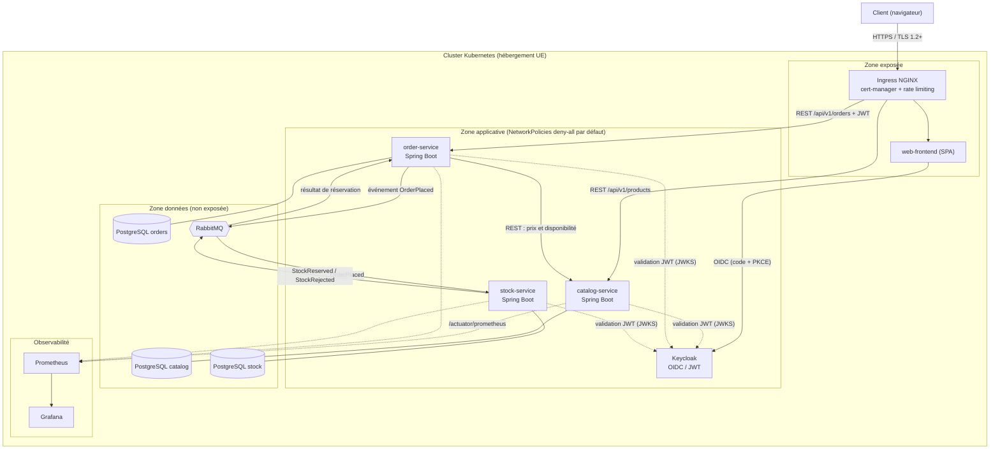

# Architecture technique et sécurité

## Principes
- Une base de données par service ; aucun accès direct aux données d'un autre service.
- Synchrone (REST, contrats OpenAPI) pour la lecture, asynchrone (RabbitMQ) pour la saga de commande.
- Chaque service est *resource server* OAuth2 : validation de la signature, de l'expiration et de l'audience du JWT.

## Mesures de sécurité par zone
| Zone | Mesures |
|---|---|
| Edge | TLS (cert-manager), rate limiting, en-têtes de sécurité (HSTS, CSP) |
| Applicative | JWT validé par service, rôles `CUSTOMER` / `MODERATOR` / `ADMIN`, images non root, limites CPU/mémoire |
| Données | Non exposée hors cluster, NetworkPolicies, secrets Kubernetes, migrations Flyway |
| Chaîne de livraison | gitleaks, SAST, SCA, scan d'images, DAST (voir `02-cicd-pipeline.md`) |
