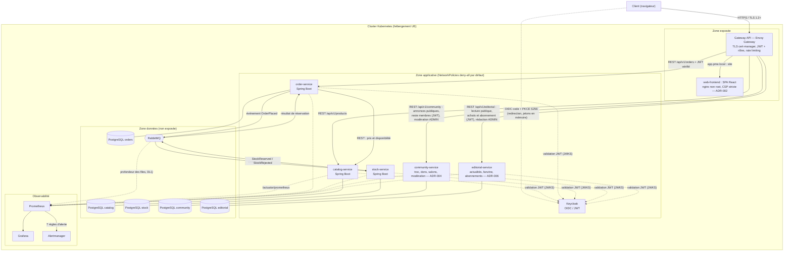

# Architecture technique et sécurité

## Principes
- Une base de données par service ; aucun accès direct aux données d'un autre service.
- Le site (`web-frontend`) n'est qu'un ensemble de fichiers statiques : le navigateur appelle l'API **sur la même origine** (`app.pme.local`), le Gateway route `/api/v1/*` vers les services et tout le reste vers nginx. Le site n'a aucun flux sortant (NetworkPolicy).
- Synchrone (REST, contrats OpenAPI) pour la lecture, asynchrone (RabbitMQ) pour la saga de commande.
- Chaque service est *resource server* OAuth2 : validation de la signature, de l'expiration et de l'audience du JWT.
- L'espace communautaire (troc, dons, salons, notifications, modération) est un service à part entière, `community-service`, avec sa base : son modèle (annonces, propositions, messages) et sa charge (relevés fréquents des discussions) sont indépendants de la vente, et il ne dépend d'aucun autre service (ADR-004). Les discussions sont relevées périodiquement par le navigateur, sans connexion persistante (ADR-005).
- Administration de la boutique (US18, US19) : gestion des produits dans le catalogue (`/api/v1/catalog/admin`), réapprovisionnement et inventaire dans le stock, suivi des commandes de tous les clients dans le service des commandes (`/api/v1/orders/admin`) ; rôle `ADMIN` exigé au Gateway et dans chaque service. Inscription des clients (US20) par Keycloak : rôle `CUSTOMER` attribué par défaut, le site ne voit jamais le mot de passe.
- Les contenus éditoriaux (actualités, articles de fond, fanzine numérique, abonnements) forment un cinquième service, `editorial-service`, sans stock ni saga : le droit de lecture est vérifié à chaque page servie, sans fichier téléchargeable (ADR-006).
- Hébergement en Europe : cluster Kubernetes managé d'un fournisseur européen (région France), bases managées chiffrées avec sauvegardes dans une seconde région de l'UE, registre d'images et supervision dans le même périmètre ; la CI ne manipule que des données fictives ; aucune ressource tierce chargée par le site (ADR-006, décision 2).
- Évolutions prévues : enchères et diffusion des productions Evil Ed (v2), projections en ligne du festival à jauge et horaires fixes (v3), chacune dans un service dédié (ADR-006, décision 3).

## Mesures de sécurité par zone
| Zone | Mesures |
|---|---|
| Edge | Gateway API (Envoy Gateway, ADR-003) : TLS 1.2+ (cert-manager), validation du JWT et du rôle dès l'entrée (`SecurityPolicy`), rate limiting (`BackendTrafficPolicy`), HSTS et CORP ajoutés aux réponses |
| Site (navigateur) | CSP stricte posée par nginx (aucun script ni style en ligne, `frame-ancestors 'none'`), jetons en mémoire, même origine que l'API (ni CORS ni cookie), aucune ressource tierce ; conteneur nginx non root en lecture seule |
| Applicative | JWT validé par service, rôles `CUSTOMER` / `ADMIN` (la modération de l'espace communautaire est confiée à `ADMIN`), images non root, limites CPU/mémoire ; espace communautaire : anti-flood par membre, propositions visibles de leurs seuls participants, identifiants des membres jamais exposés ; éditions : droit de lecture vérifié à chaque page du fanzine, rédaction et liste d'expédition réservées à `ADMIN`, contenus en texte brut (aucun HTML interprété) |
| Données | Non exposée hors cluster, NetworkPolicies (chaque base n'accepte que son service), secrets Kubernetes, migrations Flyway ; durées de conservation appliquées par les services (notifications lues 90 jours, messages de salon 365 jours, adresses de livraison du fanzine 90 jours après l'échéance) |
| Chaîne de livraison | gitleaks, SAST, SCA, scan d'images, DAST (voir `02-cicd-pipeline.md`) |
