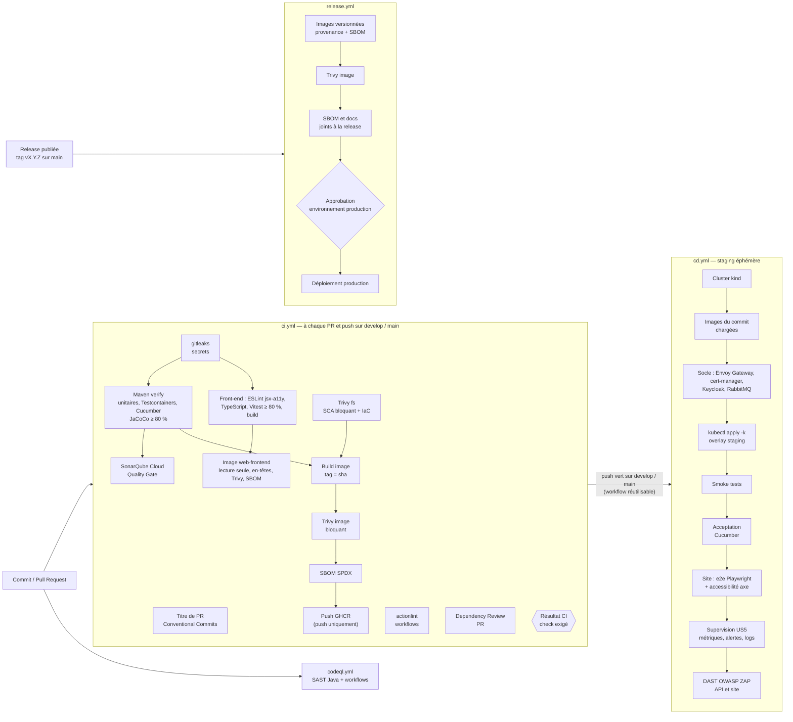

# Pipeline CI/CD DevSecOps (GitHub Actions)

Le pipeline est implémenté dans `.github/workflows/` (4 workflows). Ce document décrit le flux, les outils et les indicateurs qu'ils alimentent. La gouvernance du dépôt (branches, versions, environnements) est décrite dans `10-gouvernance-depot.md`.

## Vue d'ensemble

Le déploiement en staging est un **workflow réutilisable** (`on: workflow_call`) appelé par le job `CD staging` de `ci.yml` une fois le check « Résultat CI » vert, uniquement sur un push vers `develop` ou `main`. Il déploie donc toujours le commit qui vient d'être validé (`github.sha`). Un déclencheur `workflow_run` avait été utilisé au départ : CodeQL l'a signalé (2 alertes élevées « Cache Poisoning via execution of untrusted code »), car le SHA déployé provenait d'un autre workflow et le code s'exécutait dans le contexte privilégié de la branche par défaut. Le lancement manuel (`workflow_dispatch`) reste possible sur une branche pour valider un changement d'infrastructure avant fusion.

**Garde-fou de traçabilité** : après le déploiement, le CD vérifie que chaque service (et le site `web-frontend`, depuis le 16/11/2026) tourne avec l'image `sha-<commit>` et échoue sinon. Il a été ajouté le 15/11/2026 après la découverte, pendant l'US5, qu'une surcharge Kustomize (`kustomize edit set image <service>=…`) ne visait plus le nom d'image produit par la base : le staging déployait silencieusement l'image `:develop` au lieu de celle du commit testé. Les métriques métier de l'US5, absentes du staging, ont révélé l'écart.

## Étape → outil → indicateur alimenté

| Étape | Outil | Workflow / job | Bloquant | Indicateur alimenté (`04-indicateurs-qualite.md`) |
|---|---|---|---|---|
| Conventions | Contrôle du titre de PR | `ci.yml` / `pr-title` | Oui | Maintenabilité (historique lisible, changelog) |
| Intégrité du pipeline | actionlint, CodeQL `actions` | `ci.yml` / `lint`, `codeql.yml` | Oui | 4 — vulnérabilités (chaîne d'approvisionnement) |
| Secrets | gitleaks | `ci.yml` / `secrets` | Oui | 4 — vulnérabilités critiques = 0 |
| SCA | Trivy fs (dépendances Maven) | `ci.yml` / `sca` | Oui (critique, haute) | 4 — vulnérabilités critiques/hautes = 0 |
| IaC | Trivy config (Dockerfile, Kubernetes) | `ci.yml` / `sca` | Non (rapport dans Security) | 4 — mauvaise configuration |
| Revue des dépendances | Dependency Review | `ci.yml` / `dependency-review` | Oui (haute) | 4 |
| Tests unitaires | JUnit 5, Mockito | `ci.yml` / `build-test` | Oui | 1 — couverture ≥ 80 % (JaCoCo, contrôlée dans le job) |
| Tests d'intégration | Testcontainers (PostgreSQL, RabbitMQ réels) | `ci.yml` / `build-test` | Oui | 1 et fiabilité |
| Tests d'acceptation | Cucumber, Gherkin en français (US1 à US4, 401/403/404), contre le staging déployé | `cd.yml` | Oui | Adéquation fonctionnelle |
| Front-end : lint et types | ESLint (`jsx-a11y` strict, règles React), TypeScript strict | `ci.yml` / `frontend` | Oui | Maintenabilité, accessibilité |
| Front-end : tests | Vitest + Testing Library (composants rendus, API simulée), build sans code en ligne, budget de poids gzip (premier affichage ≤ 110 Ko, total ≤ 140 Ko) | `ci.yml` / `frontend` | Oui | 1 — couverture ≥ 80 % (lignes, `coverage-summary.json`) ; performance (3) côté navigateur |
| Image du site | Démarrage en lecture seule et contrôle des en-têtes, Trivy, SBOM | `ci.yml` / `frontend-image` | Oui | 4 |
| Tests de bout en bout | Playwright (Chromium) contre le site déployé : parcours confirmé et annulé, connexion Keycloak réelle, espace administrateur, refus selon le rôle, pages légales, en-têtes, absence de jeton dans le stockage | `cd.yml` | Oui | Adéquation fonctionnelle, sécurité |
| Accessibilité | axe-core (WCAG 2.2 A/AA, base du RGAA 4.1) sur 14 pages ou états, dont la page de connexion Keycloak, captures jointes au rapport | `cd.yml` (Playwright) | Oui (0 violation) | Utilisabilité (ISO 25010) |
| Qualité web | Lighthouse 13.6.0 (bureau) sur 3 pages, rapports HTML en artefact | `cd.yml` | Oui (seuils par catégorie) | Performance (3), utilisabilité |
| Règles d'alerte | `promtool check config` et `test rules` (`infra/monitoring/alerts.test.yml`) | `ci.yml` / `lint` | Oui | Fiabilité de la supervision |
| Analyse statique | SonarQube Cloud (Quality Gate attendu) | `ci.yml` / `build-test` | Oui | 2 — dette ≤ 5 %, duplication ≤ 3 % |
| SAST | CodeQL `java-kotlin` (security-extended) | `codeql.yml` | Alertes dans Security | 4 |
| Scan d'image | Trivy image | `ci.yml` / `image`, `release.yml` | Oui (critique, haute) | 4 |
| SBOM et provenance | Syft (SPDX), attestations BuildKit | `ci.yml` / `image`, `release.yml` | – | Intégrité logicielle (OWASP A08) |
| Déploiement | kind + Kustomize | `cd.yml` | Oui | Disponibilité (rollout réussi) |
| Smoke tests | `scripts/smoke-test.sh` | `cd.yml` | Oui | Disponibilité |
| Supervision | kube-prometheus-stack, `k8s/monitoring/verify.sh` (cibles, métriques, alertes chargées, Grafana, logs corrélés ; valeurs attendues tirées du dépôt) | `cd.yml` | Oui | US5 ; mesure du p95 (indicateur 3) |
| DAST | OWASP ZAP : baseline passif puis scan actif de l'API à partir du contrat OpenAPI, authentifié, et baseline du site (`scripts/dast.sh`) | `cd.yml` | Oui pour les règles qualifiées FAIL dans `.zap/rules.tsv` (API : injections, en-têtes) et `.zap/rules-site.tsv` (site : CSP, anti-clickjacking, Permissions-Policy) | 4 |
| Charge | JMeter (hors pipeline, démonstration en soutenance) | `load-tests/` | – | 3 — p95 < 300 ms, erreurs < 1 % |
| Production | Environnement `production` avec approbation | `release.yml` / `production` | Validation manuelle | – |

## Choix d'outillage (écarts par rapport au cadrage initial)
- **Trivy à la place d'OWASP Dependency-Check pour la SCA** : un seul outil couvre dépendances, images et IaC ; pas de clé NVD ; exécution en quelques secondes. Dependency-Check reste l'alternative évaluée dans l'expérimentation E2.
- **SonarQube Cloud** (gratuit pour un dépôt public) plutôt qu'un serveur SonarQube auto-hébergé : pas d'infrastructure à maintenir. Le job est activé dès que le secret `SONAR_TOKEN` existe.
- **CodeQL** ajouté : SAST natif GitHub, alertes centralisées dans l'onglet Security avec Trivy.
- **Playwright + axe-core** pour le front-end plutôt que Cypress : navigateurs réels pilotés sans proxy, intégration axe officielle, rapport HTML autonome avec captures. Les traces Playwright ne sont pas conservées en CI, car elles enregistrent les valeurs saisies (mots de passe éphémères du staging).
- **Actions épinglées par SHA de commit** : réponse directe à la compromission de `trivy-action` de mars 2026 (GHSA-69fq-xp46-6x23), où 76 tags de version ont été redirigés vers un code malveillant.

*Le déploiement en production n'est pas pénalisé s'il n'est pas implémenté (consignes) : le job `production` s'arrête après l'approbation tant qu'aucun cluster n'est configuré.*
