# Pipeline CI/CD DevSecOps (GitHub Actions)

```mermaid
flowchart LR
    A["Commit / Pull Request"] --> B["Secrets<br/>gitleaks"]
    B --> C["Build + tests unitaires<br/>JUnit, JaCoCo"]
    C --> D["Analyse statique<br/>SonarQube Quality Gate"]
    D --> E["SCA<br/>OWASP Dependency-Check"]
    E --> F["Build image Docker<br/>tag = SHA du commit"]
    F --> G["Scan image<br/>Trivy"]
    G --> H["Tests d'intégration et d'acceptation<br/>Testcontainers, Cucumber"]
    H --> I["Push registre<br/>GHCR"]
    I --> J["Déploiement staging<br/>Kustomize / kubectl"]
    J --> K["DAST<br/>OWASP ZAP"]
    K --> L["Smoke tests + supervision"]
    L --> M{"Validation manuelle"}
    M -->|"approuvé"| N["Production"]
```

## Étape → mesure de sécurité → indicateur alimenté
| Étape | Mesure de sécurité | Indicateur qualité alimenté |
|---|---|---|
| gitleaks | Aucun secret dans le dépôt | Vulnérabilités critiques = 0 |
| Tests unitaires + JaCoCo | Non-régression des règles métier | Couverture ≥ 80 % |
| SonarQube | SAST, dette, duplication | Ratio de dette ≤ 5 % |
| Dependency-Check, Trivy | SCA et scan d'image bloquants | Vulnérabilités critiques/hautes = 0 |
| Intégration / acceptation | Autorisations testées (401/403) | Adéquation fonctionnelle |
| ZAP (DAST) | Test dynamique sur staging | Vulnérabilités critiques/hautes = 0 |
| JMeter (hors pipeline obligatoire) | Tenue en charge | p95 < 300 ms, erreurs < 1 % |

*Le déploiement en pré-production n'est pas pénalisé s'il n'est pas implémenté ; la cible reste le déploiement sur cluster.*
