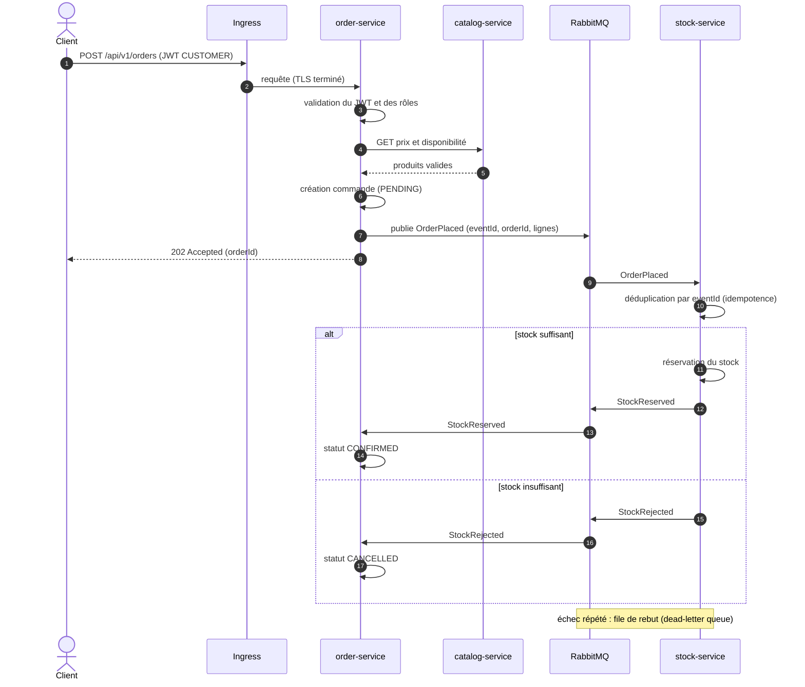

# Saga de commande (chorégraphie)

## Garanties visées
- **Idempotence** : un même `eventId` rejoué ne décrémente le stock qu'une seule fois.
- **Fiabilité** : files durables, accusés de réception manuels, temporisation des nouvelles tentatives, dead-letter queue.
- **Traçabilité** : `correlationId` propagé de l'Ingress aux événements et aux logs.
