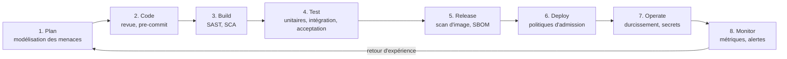

# Cycle de vie du développement — démarche DevSecOps

La sécurité est traitée à **chaque** étape (« shift left »), pas en fin de projet. Chaque étape produit une **preuve** (artefact, rapport) et alimente un des 4 indicateurs de `04-indicateurs-qualite.md`.

| # | Étape | Mesures de sécurité | Outils | Preuve / artefact | Indicateur alimenté |
|---|---|---|---|---|---|
| 1 | **Plan** | Modélisation des menaces STRIDE sur le flux de commande ; exigences de sécurité rattachées aux user stories (critères 401/403) ; classification des données (personnelles, commande) | Atelier STRIDE, backlog GitHub | Tableau de menaces, US avec critères de sécurité | Vulnérabilités (prévention) |
| 2 | **Code** | Branche `main` protégée, revue de code obligatoire (1 approbation), commits signés recommandés, hooks pre-commit de détection de secrets, conventions de code sécurisé (validation des entrées, requêtes paramétrées) | Pull requests, gitleaks, EditorConfig | PR approuvées, rapport gitleaks | Vulnérabilités critiques = 0 |
| 3 | **Build** | Compilation reproductible, SAST bloquant (Quality Gate), analyse des dépendances (SCA), versions de dépendances figées | Maven, SonarQube, OWASP Dependency-Check | Rapport Sonar, rapport SCA | Dette ≤ 5 %, vulnérabilités |
| 4 | **Test** | Tests unitaires, d'intégration (Testcontainers), d'acceptation (Cucumber) ; tests négatifs de sécurité (jeton absent, rôle insuffisant, accès à la commande d'autrui) | JUnit 5, Testcontainers, RestAssured, Cucumber | Rapports de tests, couverture JaCoCo | Couverture ≥ 80 % |
| 5 | **Release** | Image minimale non root, scan d'image bloquant (critique/haute), génération d'un SBOM, tag immuable = SHA du commit | Docker, Trivy, Syft | Image taguée, rapport Trivy, SBOM | Vulnérabilités critiques/hautes = 0 |
| 6 | **Deploy** | Déploiement déclaratif versionné, NetworkPolicies deny-all, limites CPU/mémoire, secrets via Secrets Kubernetes, validation manuelle avant production, test DAST sur staging | Kustomize, kubectl, OWASP ZAP | Manifestes versionnés, rapport ZAP | Vulnérabilités critiques/hautes = 0 |
| 7 | **Operate** | TLS automatisé et renouvelé (cert-manager), rotation des secrets, mise à jour régulière des images de base, sauvegarde des bases, moindre privilège | cert-manager, Dependabot / Renovate | Certificats valides, PR de mise à jour | Vulnérabilités (dérive dans le temps) |
| 8 | **Monitor** | Métriques RED, alertes sur taux d'erreur et latence, journalisation des événements de sécurité (échecs d'authentification, 403), `correlationId` | Micrometer, Prometheus, Grafana | Dashboards, alertes | p95 < 300 ms, erreurs < 1 % |

## Gouvernance de la qualité
- **Definition of Done** d'une user story : critères d'acceptation automatisés et verts ; Quality Gate Sonar passé ; aucun secret ni vulnérabilité critique/haute ; endpoint protégé testé en 401/403 ; métriques exposées ; documentation à jour.
- **Définition de « prêt à déployer »** : pipeline complet vert + approbation manuelle pour la production.
- **Boucle de retour** : les résultats de l'étape 8 et des scans nourrissent la planification (étape 1) via le backlog technique.

## Modélisation des menaces — flux de commande (STRIDE, extrait)
| Menace | Catégorie | Contre-mesure |
|---|---|---|
| Usurpation d'identité d'un client | Spoofing | OIDC Keycloak, validation du JWT (signature, expiration, audience) |
| Modification d'une commande ou du prix en transit | Tampering | TLS, prix relu côté serveur depuis `catalog-service` (jamais accepté du client) |
| Contestation d'une commande | Repudiation | Journalisation horodatée avec `correlationId` et identifiant utilisateur |
| Fuite de commandes d'un autre client | Information disclosure | Contrôle d'accès par propriétaire (403/404), tests d'acceptation dédiés |
| Saturation du service | Denial of service | Rate limiting à l'Ingress, limites de ressources, HPA |
| Élévation de privilèges | Elevation of privilege | Rôles minimaux, vérification côté service (pas seulement côté interface) |
