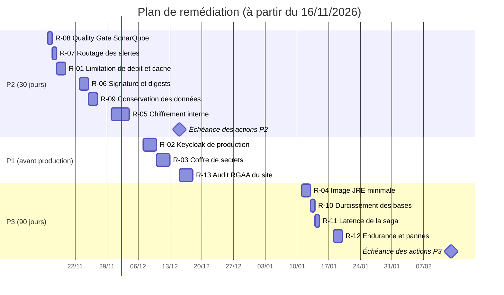

# 11 — Plan de remédiation

> **Issue** : #39 · **Date** : 15/11/2026 · **Entrée** : registre des vulnérabilités (`docs/13-analyse-securite.md`).
> **Règles appliquées** : délais de la politique de sécurité (§6) comptés à partir du 15/11/2026 — haute 7 jours, moyenne 30 jours, basse 90 jours — et exceptions justifiées, datées, avec mesure compensatoire.

## 1. Contexte qui fixe les priorités

| Facteur | Conséquence sur le plan |
|---|---|
| **Plateforme commerciale**, « la sécurité est une contrainte forte » (contexte) : le catalogue est la vitrine, les pics viennent des sorties exclusives (figurines du collectif Evil Ed), du fanzine et du festival | La disponibilité du catalogue et du parcours d'achat passe avant l'optimisation ; un pic légitime ne doit pas être confondu avec un abus |
| **Données personnelles** (comptes, commandes, centres d'intérêt pour les recommandations) | RGPD art. 32 (sécurité du traitement) et art. 5.1.e (limitation de la conservation) : chiffrement des échanges et des secrets, durée de conservation définie |
| **Hébergement en Europe** exigé ; l'entreprise utilise déjà un fournisseur cloud français | Coffre-fort de secrets, bases managées et CDN choisis chez des fournisseurs qui hébergent et opèrent dans l'UE |
| **Équipe IT réduite** (un·e architecte ex-lead developer, deux développeur·euse·s juniors en alternance) | Préférer les mécanismes intégrés à la plateforme (Gateway, opérateurs, services managés) aux outils à opérer soi-même ; automatiser plutôt que documenter une procédure manuelle |
| **Évolutions annoncées** (enchères en v2, diffusion de films en v3) | Les fondations posées ici (limitation de débit globale, signature des images, coffre de secrets) servent directement ces fonctions plus exposées |

Priorités :
- **P1** : condition de mise en production (le POC n'a pas de production : ces actions bloquent le premier déploiement réel) ;
- **P2** : délai de 30 jours (sévérité moyenne) ;
- **P3** : délai de 90 jours (sévérité basse) ou amélioration continue.

## 2. Actions

| Action | Constats | Recommandation | Justification | Coût | Priorité, échéance | Vérification |
|---|---|---|---|---|---|---|
| **R-01** Plafonner le trafic | V-11 | Limitation de débit sur la route du catalogue (par adresse IP), passage à la limitation **globale** d'Envoy Gateway (compteurs partagés dans Redis) pour que le plafond tienne avec plusieurs instances d'Envoy ; `Cache-Control: public, max-age=60` sur le catalogue et CDN hébergé dans l'UE ; plafond d'instances du HPA aligné sur le budget | 1 900 req/s d'un seul client ont été acceptées et ont porté le catalogue à son maximum d'instances : un abus consomme la capacité prévue pour les clients et le budget cloud. Le cache absorbe aussi les pics légitimes (sorties exclusives, festival) | 2 j | P2 — 15/12/2026 | Palier de stress : réponses 429 au-delà du plafond, p95 des autres clients < 300 ms |
| **R-02** Keycloak de production | V-17, V-16 | Image Keycloak optimisée (`kc.sh build`) en mode `start`, PostgreSQL managé UE, 2 instances ; royaume de production généré **sans** client `pme-tests` ni comptes de démonstration ; MFA pour les administrateurs ; console d'administration réservée au réseau d'administration | Un client à mot de passe direct en production contournerait l'authentification forte ; l'instance unique en mode développement n'est ni durable ni disponible | 3 j | **P1** — avant production | Export du royaume de production sans `pme-tests` ; Trivy sans l'exception KSV-0014 ; test de bascule d'instance |
| **R-03** Secrets | V-13 | Chiffrement d'etcd par KMS ; External Secrets Operator alimenté par un coffre hébergé dans l'UE (OpenBao, Vault ou KMS du fournisseur) ; rotation des mots de passe des bases et du broker tous les 90 jours | RGPD art. 32 : un accès aux sauvegardes d'etcd ne doit pas livrer les accès aux bases de données personnelles | 3 j | **P1** — avant production | Aucun secret en clair dans etcd ; rotation exécutée sans interruption |
| **R-04** Veille des images | V-01 | Rapport hebdomadaire (en place) ; reconstruction automatique hebdomadaire des images ; dès qu'un correctif Debian est publié pour une haute, livraison sous 7 jours ; évaluer une image JRE minimale (runtime `jlink` sur distroless `base`) pour retirer expat et util-linux | Les 8 hautes n'ont pas de correctif et ne sont pas atteignables par la JVM (exception) ; la reconstruction régulière fait entrer les correctifs dès leur sortie, l'image minimale réduit la surface | 2 j | P3 — 13/02/2027 (veille continue) | Rapport hebdomadaire : hautes « avec correctif » = 0 ; nombre de paquets de l'image réduit |
| **R-05** Chiffrement interne | V-12 | mTLS entre le Gateway et les services par un maillage léger (Istio ambient ou Linkerd) ; TLS vérifié vers PostgreSQL (`sslmode=verify-full`) et RabbitMQ (port 5671) | RGPD art. 32 : les commandes (données personnelles) circulent en clair dans le cluster ; les NetworkPolicies limitent qui parle à qui, pas qui écoute | 4 j | P2 — 15/12/2026 ; **P1** pour la production | Capture réseau sans contenu lisible ; connexions refusées sans certificat |
| **R-06** Intégrité de la chaîne | V-14, V-15 | Signature *keyless* des images par cosign (identité OIDC du workflow) dans `release.yml` ; vérification à l'admission (Kyverno `verifyImages`) ; images tierces et image ZAP épinglées par digest, mises à jour par Dependabot | Seules les images produites par la CI du dépôt doivent pouvoir tourner ; un tag réécrit chez un tiers ne doit pas changer ce qui est exécuté (leçon de V-09) | 2 j | P2 — 15/12/2026 | Une image non signée est refusée par le cluster ; plus aucune référence par tag seul |
| **R-07** Réaction aux alertes | V-19 | Routage Alertmanager vers l'astreinte (messagerie d'équipe et courriel), regroupement, silences de maintenance, lien de chaque alerte vers sa procédure (`docs/12` §5) | Une alerte que personne ne reçoit ne réduit aucun délai de détection | 1 j | P2 — 15/12/2026 | Alerte de test reçue sur le canal d'astreinte |
| **R-08** Quality Gate | V-20 | Activer SonarQube Cloud (monorepo, 3 projets, secret `SONAR_TOKEN`) et le cas 5 de l'expérimentation E2 (issue #32) | Mesurer l'indicateur 2 (dette ≤ 5 %, duplication ≤ 3 %) et bloquer sa dégradation | 0,5 j | P2 — 15/12/2026 | Étape « Indicateur 2 » exécutée et verte sur `develop` |
| **R-09** Conservation des données | V-23 | Définir avec le DPO une durée de conservation par catégorie (commande ayant une valeur comptable, compte inactif) ; purge ou anonymisation planifiée ; inscrire le traitement au registre | RGPD art. 5.1.e : une donnée personnelle ne se conserve pas sans durée définie | 2 j | P2 — 15/12/2026 | Tâche de purge testée ; registre des traitements à jour |
| **R-10** Durcissement des bases | V-21 | UID/GID > 10000 et limites CPU pour PostgreSQL, ou bases managées UE en production | Réduit l'impact d'une évasion de conteneur ; un service managé apporte sauvegardes et correctifs | 1 j | P3 — 13/02/2027 | Trivy config sans KSV-0011, KSV-0020, KSV-0021 |
| **R-11** Latence de la saga | — (constat du test de charge) | Réveiller le publieur de la boîte d'envoi après validation (PostgreSQL `LISTEN/NOTIFY`) au lieu d'un relevé toutes les 500 ms | Durée de saga p95 de 0,8 s due à la conception ; le client voit sa commande confirmée plus vite | 1 j | P3 — 13/02/2027 | Durée de saga p95 < 200 ms au palier nominal |
| **R-12** Tests complémentaires | — (limites de `docs/14`) | Test d'endurance de 2 h, tests de panne (nœud RabbitMQ, base), charge depuis un générateur séparé du cluster | Les mesures actuelles partagent la machine du système testé et ne couvrent ni les fuites mémoire ni les pannes en charge | 2 j | P3 — 13/02/2027 | Rapports d'endurance et de panne archivés |
| **R-13** Accessibilité du site | V-26 | Audit RGAA 4.1 manuel des 106 critères sur l'échantillon de pages (lecteurs d'écran NVDA et VoiceOver, navigation clavier, zoom 200 %), puis mise à jour de la déclaration d'accessibilité (publiée le 17/11/2026 avec l'état « non conforme ») et publication du schéma pluriannuel ; la page de connexion Keycloak (thème « pme » livré le 17/11) est incluse dans l'échantillon | Obligation légale pour un site marchand dès que l'entreprise dépasse le seuil des microentreprises (directive 2019/882 transposée, en vigueur depuis juin 2025) ; les contrôles automatisés (axe) ne couvrent qu'environ 30 % des critères | 3 j | **P1** — avant mise en ligne | Grille RGAA remplie, taux de conformité publié, déclaration en ligne |

**Risques acceptés** (aucune action) : V-22, identifiants de développement de l'historique Git, jamais valides ailleurs que sur un poste ; V-24, option `--kubelet-insecure-tls` limitée au cluster kind du staging.

**Exceptions datées** : V-01 (réexamen hebdomadaire par le rapport de sécurité) et V-16 (`.trivyignore.yaml`, levée par R-02).

## 3. Calendrier et effort

| Priorité | Actions | Effort |
|---|---|---|
| P1 (avant production) | R-02, R-03, R-13 (+ R-05 pour la production) | 9 j |
| P2 (30 jours) | R-01, R-05, R-06, R-07, R-08, R-09 | 11,5 j |
| P3 (90 jours) | R-04, R-10, R-11, R-12 | 6 j |
| **Total** | 13 actions | **26,5 jours-personne** |

## 4. Suivi

- Chaque action est une issue GitHub (labels `type:security`, `phase:3-remediation`, priorité ; jalon « Remédiation (après le POC) ») et suit le flux habituel : branche, PR, CI verte, preuve dans le résumé du run. Correspondance : R-01 #73, R-02 #74, R-03 #75, R-04 #76, R-05 #77, R-06 #78, R-07 #79, R-08 #32, R-09 #80, R-10 #81, R-11 #82, R-12 #83, R-13 #94.
- Le registre (`docs/13`) est mis à jour à chaque clôture ; l'indicateur 4 est relu à chaque jalon.
- Le rapport de sécurité hebdomadaire et la veille (avis GitHub, Debian, OWASP) peuvent ajouter des constats : ils entrent dans le registre avec la sévérité retenue et le délai de la politique.
