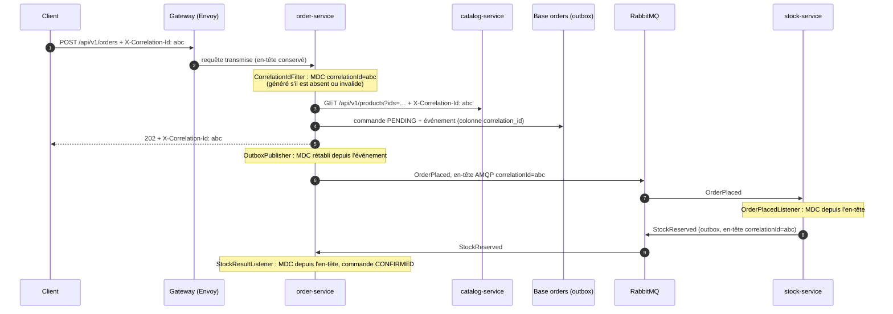

# 12 — Observabilité et supervision (US5)

> **User story US5** : en tant qu'équipe, nous voulons métriques et logs afin de diagnostiquer.
> **Critères d'acceptation** : les métriques RED sont visibles dans Grafana (tableau de bord versionné) ; un `correlationId` relie les logs d'une commande entre services et événements.
> **Issue** : #29 · **Fondement** : expérimentation E4 (`docs/experimentations/E4.md`), qui a validé la pile sur un seul service.

## 1. Ce qui est en place

| Pilier | Choix | Où |
|---|---|---|
| Métriques techniques (RED) | Micrometer → `/actuator/prometheus`, histogrammes de latence activés | `application.yml` des 3 services |
| Métriques métier de la saga | Compteurs, histogramme et jauge Micrometer | `order/observability/SagaMetrics`, `stock/observability/ReservationMetrics` |
| Profondeur des files RabbitMQ | Plugin `rabbitmq_prometheus`, point `/metrics/detailed` | `infra/monitoring/prometheus.yml`, `k8s/monitoring/servicemonitors.yaml` |
| Logs corrélés | `X-Correlation-Id` → MDC → motif de log `[service,correlationId]`, propagé en REST et dans les messages | `CorrelationIdFilter`, `CatalogClient`, `OutboxPublisher`, listeners |
| Alertes | 6 règles Prometheus, **testées en CI** avec `promtool test rules` | `infra/monitoring/alerts.yml`, `alerts.test.yml` |
| Tableau de bord | Grafana `pme-red`, provisionné sans clic | `infra/monitoring/grafana/dashboards/pme-red.json` |

**Source unique** : règles et tableau de bord sont versionnés une seule fois dans `infra/monitoring/`. Docker compose les monte tels quels en local ; sur Kubernetes, `k8s/monitoring/install.sh` convertit `alerts.yml` en `PrometheusRule` et charge le tableau de bord dans un ConfigMap lu par Grafana. Le poste du développeur et le staging affichent donc exactement les mêmes indicateurs.

## 2. Propagation du correlationId à travers la saga



Le correlationId est accepté seulement s'il respecte `[A-Za-z0-9-]{1,64}` : un client ne peut pas injecter de contenu arbitraire dans les journaux (OWASP A09). Il traverse aussi l'asynchrone : il est stocké avec l'événement dans la boîte d'envoi, donc même un événement publié plusieurs minutes plus tard (broker indisponible) reste rattaché à la requête d'origine.

Lignes produites sur le staging pour la commande des smoke tests (`smoke-saga-1`, run CD du 15/11/2026, identifiants abrégés ; l'identifiant client figure dans le log de création depuis l'analyse de sécurité du J4) :

```text
INFO [order-service,smoke-saga-1] … [nio-8082-exec-1] c.p.order.domain.OrderService           : Commande 61ccd396-… créée pour le client 3f9c…-… (1 ligne(s), total 5990 centimes)
INFO [order-service,smoke-saga-1] … [   scheduling-1] c.p.order.messaging.OutboxPublisher     : Événement … publié (order.placed)
INFO [stock-service,smoke-saga-1] … [ntContainer#0-1] c.p.s.reservation.ReservationService    : Stock réservé pour la commande 61ccd396-… (1 produit(s))
INFO [stock-service,smoke-saga-1] … [   scheduling-1] c.p.stock.messaging.OutboxPublisher     : Événement … publié (stock.reserved)
INFO [order-service,smoke-saga-1] … [ntContainer#0-1] c.p.order.messaging.StockResultListener : Résultat de stock StockReserved pour la commande 61ccd396-… : commande finalisée
```

Les threads diffèrent (requête HTTP, publication planifiée, consommateur RabbitMQ) et les services aussi : seul le correlationId relie ces lignes.

## 3. Catalogue des métriques

| Métrique Prometheus | Type | Libellés | Signification |
|---|---|---|---|
| `http_server_requests_seconds_count` / `_bucket` | compteur / histogramme | `service`, `uri`, `status` | Débit, erreurs et latence (RED) ; les appels `/actuator/*` sont exclus des indicateurs |
| `pme_orders_total` | compteur | `event` = `placed`, `confirmed`, `cancelled` | Commandes à chaque étape de la saga |
| `pme_saga_duration_seconds` | histogramme | — | Durée entre la création d'une commande et son état final |
| `pme_stock_reservations_total` | compteur | `outcome` = `reserved`, `rejected`, `duplicate` | Issue des demandes de réservation ; `duplicate` prouve en production l'idempotence validée par E3 |
| `pme_outbox_pending` | jauge | `service` | Événements écrits mais pas encore publiés (broker injoignable si elle reste > 0) |
| `rabbitmq_detailed_queue_messages_ready` | jauge | `queue` | Messages en attente par file, dont les files de rebut `*.dlq` |
| `jvm_memory_used_bytes` | jauge | `area` | Mémoire JVM |

Les compteurs métier ne bougent **qu'après validation de la transaction** (`TransactionSynchronization.afterCommit`) : une commande annulée par un rollback n'est jamais comptée.

## 4. Tableau de bord « PME — RED et saga des microservices »

| Ligne | Panneaux |
|---|---|
| RED | Débit (req/s), erreurs 5xx (%), latence p95 avec seuil 300 ms (indicateur 3), mémoire JVM |
| Saga de commande | Commandes par étape, durée de saga p95, réservations par issue, boîte d'envoi en attente, messages en file de rebut |
| Capacité | Instances actives par service (mise à l'échelle horizontale, test de charge) |

## 5. Alertes

| Alerte | Condition | Gravité | Première action |
|---|---|---|---|
| `ServiceIndisponible` | cible `up == 0` pendant 1 min | critique | `kubectl -n pme get pods`, événements et logs du pod |
| `TauxErreurEleve` | > 1 % de 5xx (hors `/actuator`) pendant 2 min | critique | Filtrer les logs `ERROR` du service ; vérifier ses dépendances (base, catalogue, broker) |
| `LatenceP95Elevee` | p95 > 300 ms pendant 5 min | avertissement | Panneau latence par service ; saturation CPU ou mémoire, requêtes SQL lentes |
| `BoiteEnvoiBloquee` | `pme_outbox_pending > 0` pendant 2 min | critique | RabbitMQ joignable ? Les commandes restent PENDING mais aucun événement n'est perdu : ils partiront au retour du broker |
| `MessagesEnRebut` | au moins un message dans une file `*.dlq` pendant 1 min | avertissement | Lire le message (console RabbitMQ), corriger la cause, puis le rejouer ou le purger |
| `TauxAnnulationEleve` | > 20 % de commandes annulées sur 15 min pendant 5 min | avertissement | Ruptures de stock : prévenir l'équipe catalogue et l'administrateur des stocks |

Chaque règle a un test unitaire dans `infra/monitoring/alerts.test.yml` : cas nominal sans alerte, panne de service, broker injoignable, 5 % d'erreurs (en vérifiant que les appels `/actuator` ne diluent pas le taux), message en rebut et vague d'annulations. La CI (job « Lint ») exécute `promtool check config` et `promtool test rules` à chaque pull request : une règle mal écrite ne peut pas être fusionnée.

## 6. Vérification

**En continu (staging)** : après les smoke tests, `cd.yml` installe la supervision (`k8s/monitoring/install.sh`) puis lance `k8s/monitoring/verify.sh`, qui échoue le déploiement si l'un des contrôles suivants n'est pas tenu :

| Contrôle | Attendu |
|---|---|
| Cibles collectées et actives | 3 services + RabbitMQ |
| Métriques RED et métier (commandes créées, confirmées, annulées, réservations, durées) | présentes et non nulles |
| Boîte d'envoi | vide |
| Files de rebut supervisées | 2 |
| Règles d'alerte chargées dans Prometheus | 6 |
| Tableau de bord `pme-red` dans Grafana, données lisibles par la source « prometheus » | 11 panneaux, valeur non nulle |
| Logs reliés par `smoke-saga-1` | ≥ 3 lignes dans order-service, ≥ 2 dans stock-service |

Le résultat (tableau et lignes de logs corrélées) est publié dans le résumé du run GitHub Actions.

**En local** :

```bash
cd infra && ./init-env.sh && docker compose --profile app up -d --build
# Grafana : http://localhost:3000 (admin / GRAFANA_ADMIN_PASSWORD de infra/.env) → « PME — RED et saga des microservices »
# Prometheus : http://localhost:9090/alerts → 6 règles chargées
docker compose logs order-service stock-service | grep <correlationId>
```

## 7. Diagnostiquer une commande restée PENDING

1. Récupérer l'en-tête `X-Correlation-Id` de la réponse `202` (ou le fournir à l'appel).
2. `kubectl -n pme logs deploy/order-service | grep <id>` : la commande est-elle créée ? l'événement est-il publié ?
3. Si l'événement n'est pas publié : panneau « Boîte d'envoi en attente » et alerte `BoiteEnvoiBloquee` → broker.
4. `kubectl -n pme logs deploy/stock-service | grep <id>` : réservation faite ou refusée ? Rien : panneau « Messages en file de rebut » (message illisible ou en échec après 3 tentatives).
5. Résultat publié mais commande toujours PENDING : vérifier la file `order.stock-result` et sa file de rebut.

## 8. Limites et évolutions

- **Logs non centralisés** : lus avec `kubectl logs` / `docker compose logs`. Loki (léger, indexé par libellés) est l'option retenue par E4 si la centralisation devient nécessaire ; ELK a été écarté pour son coût mémoire.
- **Pas de traces distribuées** : le correlationId suffit pour 3 services. Au-delà, OpenTelemetry (Micrometer Tracing) donnerait la durée de chaque segment ; le nom d'en-tête pourra alors s'aligner sur `traceparent` (W3C).
- **Alertes non routées** : Alertmanager les reçoit ; en production, router les critiques vers l'astreinte (messagerie, courriel) et définir les silences de maintenance.
- **Staging éphémère** : les métriques disparaissent avec le cluster kind ; en production, conserver au moins 15 jours de rétention (retours d'expérience et suivi de l'indicateur 3).
