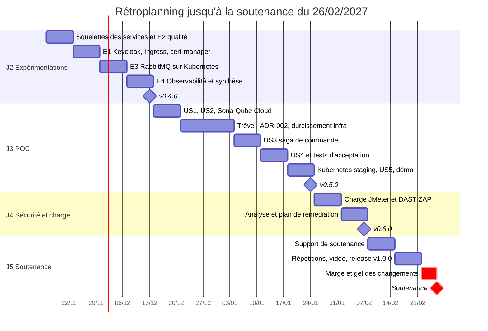

# Suivi d'avancement

Le suivi détaillé est tenu dans GitHub : [jalons](https://github.com/mbanzaroger/petitemaisonepouvante/milestones), [issues](https://github.com/mbanzaroger/petitemaisonepouvante/issues) et kanban (GitHub Projects). Ce tableau en donne la synthèse. Les numéros #9, #11 et #14 sont des pull requests Dependabot (mises à jour des images de `infra/`).

| Jalon | Version | Échéance | État | Issues |
|---|---|---|---|---|
| J0 — Cadrage | v0.1.0 | 10/10/2026 | ✅ Terminé | #1 à #3 |
| J1 — Processus qualité (phase 1) | v0.2.0 | 10/10/2026 | ✅ Terminé | #4 à #8, #10, #12 |
| Industrialisation CI/CD et audit | v0.3.0 | 14/11/2026 | ✅ Terminé | #13, #15, #16, #17 |
| J2 — Expérimentations (E1 à E4) + squelettes | v0.4.0 | 13/12/2026 | 🔲 À faire | #18 à #24 |
| J3 — Développement du POC | v0.5.0 | 24/01/2027 | 🔲 À faire | #25 à #35 |
| J4 — Sécurité, charge, remédiation | v0.6.0 | 07/02/2027 | 🔲 À faire | #36 à #39 |
| J5 — Soutenance | v1.0.0 | 25/02/2027 | 🔲 À faire | #40, #41 |

## Rétroplanning — soutenance le vendredi 26/02/2027

15 semaines restent au 14/11/2026. Les squelettes des services (#24) sont avancés au jalon J2 et menés avec E2 : la CI mesure ainsi les indicateurs dès la première semaine. La trêve des fêtes porte des tâches courtes, et 2,5 semaines de marge sont réservées avant la soutenance (environ 17 % du temps restant), dont 4 jours de gel des changements.

| Semaine | Dates | Objectif | Issues |
|---|---|---|---|
| S1 | 16/11 → 22/11 | Squelettes des 3 services, pipeline qualité mesuré (E2) | #24, #19 |
| S2 | 23/11 → 29/11 | E1 : Keycloak, Ingress NGINX, cert-manager sur kind | #18 |
| S3 | 30/11 → 06/12 | E3 : RabbitMQ, saga, DLQ, idempotence | #20 |
| S4 | 07/12 → 13/12 | E4 : observabilité ; synthèse adoption/rejet ; **v0.4.0** | #21, #22 |
| S5 | 14/12 → 20/12 | US1 catalogue, US2 authentification, SonarQube Cloud | #25, #26, #32 |
| Trêve | 21/12 → 03/01 | Tâches courtes : ADR-002 front-end, durcissement de l'infra locale, PR Dependabot | #34, #33 |
| S6 | 04/01 → 10/01 | US3 : commande et saga order ↔ stock | #27 |
| S7 | 11/01 → 17/01 | US4 historique, tests d'acceptation Cucumber en CI | #28, #30 |
| S8 | 18/01 → 24/01 | Manifestes Kubernetes et staging, US5, script de démo ; **v0.5.0** | #31, #29, #35 |
| S9 | 25/01 → 31/01 | Test de charge JMeter, DAST ZAP | #36, #37 |
| S10 | 01/02 → 07/02 | Analyse de sécurité, plan de remédiation ; **v0.6.0** | #38, #39 |
| S11 | 08/02 → 14/02 | Support de soutenance, schémas finaux | #40 |
| S12 | 15/02 → 21/02 | Répétitions chronométrées, vidéo de secours, **release v1.0.0** le 19/02 | #41 |
| Marge | 22/02 → 25/02 | Gel des changements : corrections bloquantes uniquement | – |

**Règles de pilotage** : point d'avancement chaque dimanche sur le kanban ; un jalon en retard de plus de 3 jours consomme la marge et déclenche un arbitrage de périmètre. Ordre de sacrifice si besoin : US5 (garder les métriques, alléger le dashboard), ADR-002 (démo par l'API), E4 (fusionnée avec US5).

## Jalon 1 — détail
| # | Issue | Document |
|---|---|---|
| 4 | Indicateurs qualité et dette technique | `04-indicateurs-qualite.md` |
| 5 | Schéma CI/CD détaillé | `02-cicd-pipeline.md` |
| 6 | Cycle DevSecOps complet | `05-cycle-devsecops.md` |
| 7 | Politique de tests | `06-politique-tests.md` |
| 8 | Politique de sécurité | `07-politique-securite.md` |
| 10 | Cartographie des compétences | `08-competences.md` |
| 12 | Action de formation | `09-formation.md` |

## Industrialisation (v0.3.0) — détail
| # | Issue | Livrable |
|---|---|---|
| 13 | Gouvernance du dépôt | `CONTRIBUTING.md`, `10-gouvernance-depot.md`, modèles d'issues et de PR |
| 15 | Pipelines GitHub Actions | `.github/workflows/`, `02-cicd-pipeline.md` |
| 16 | CI rouge (trivy-action supprimé) | Actions épinglées par SHA |
| 17 | Audit du projet | `audit/audit-2026-11-14.md` |
